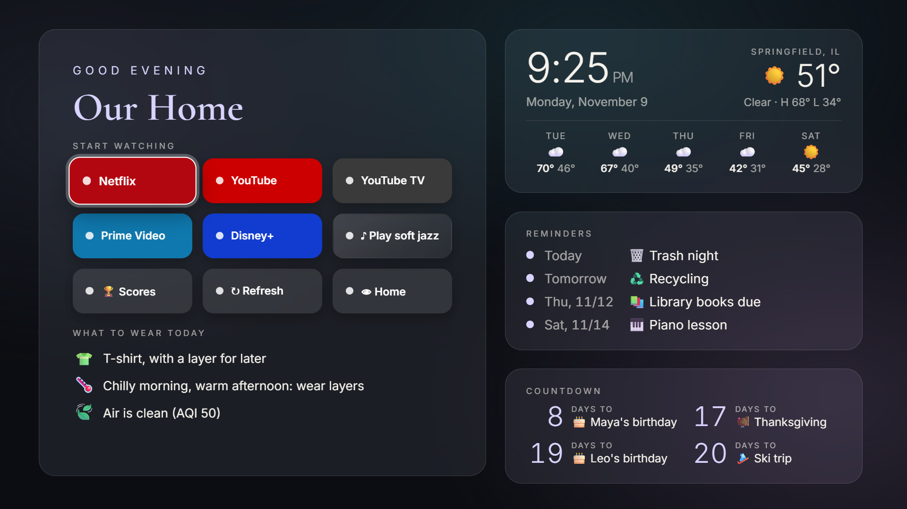

# Family TV Home Screen

Turn your TV's home screen into your family's: weather, birthdays, trash day, your teams' games and kid-safe local news. Your apps stay one click away, and the ads are gone.

**Free. No accounts. Your family's info stays on your TV. Undo anytime.**

👉 **[Step-by-step guide](https://arags01-cmd.github.io/family-tv-home/)**

## Downloads

Get them from the [latest release](https://github.com/arags01-cmd/family-tv-home/releases/latest):

| File | What it's for |
|---|---|
| `Family-TV-Setup-Windows.exe` | Setup app for Windows. Finds your TV, installs the home screen, optional cleanup, and Restore. |
| `Family-TV-Setup-Mac.dmg` | The same setup app for Mac. |
| `Family-TV-Home-Screen.apk` | The TV app on its own, for Fire TV owners without a computer (install with the Downloader app). |

The apps aren't signed by Apple or Microsoft, so your computer shows a warning the first time. The guide shows how to open them.

## Works with

Fire TV (sticks and TVs from Toshiba, Insignia and Amazon) and Google TV / Android TV (Chromecast with Google TV, Onn, Sony, TCL, Hisense).

## Privacy

- No accounts, no sign-ups, no tracking.
- Names, birthdays and reminders are saved only on your TV.
- The phone settings page works only on your home Wi-Fi, with a code shown on the TV.
- The TV only fetches public things: weather, scores and local headlines.

## Say thanks

It's free. If it made your TV nicer, you can [buy me a coffee on Ko-fi](https://ko-fi.com/familytvhomescreen). Completely optional.
